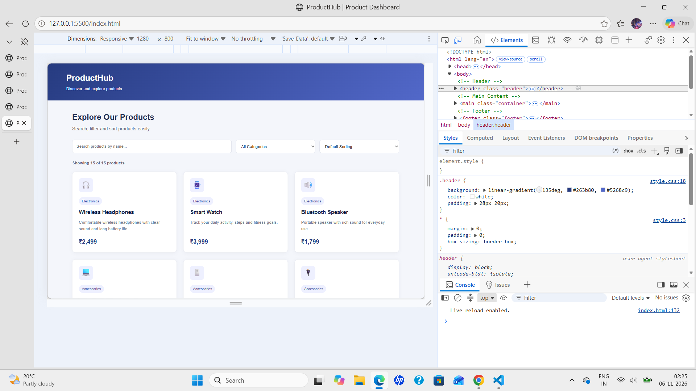
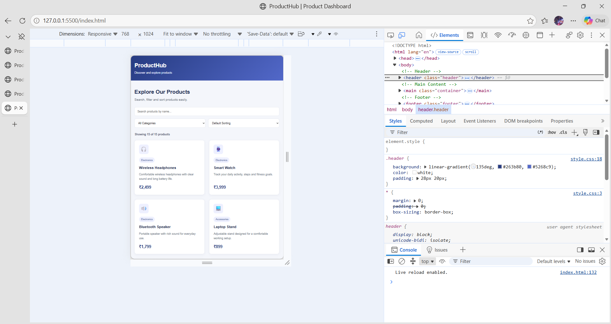
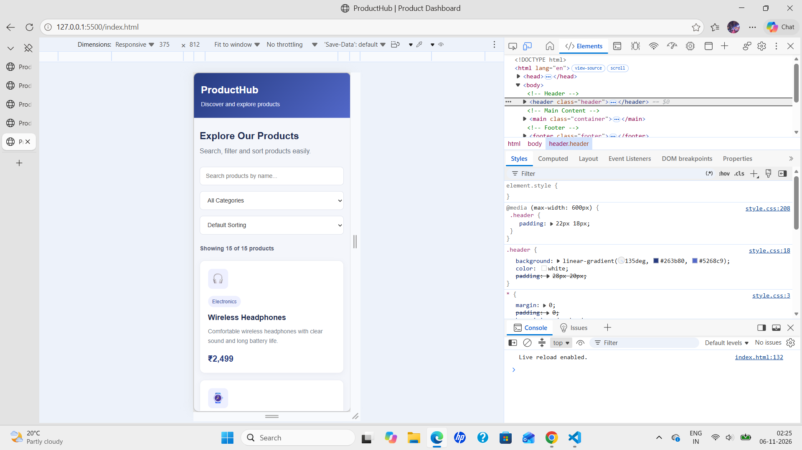

# ProductHub – Searchable Product Listing Dashboard

A responsive and interactive product listing dashboard built using HTML, CSS, JavaScript, and JSON.

## About the Project

ProductHub is a searchable product dashboard that allows users to explore products easily. Users can search for products, filter them by category, and sort them by name or price.

The dashboard loads product information dynamically from a local JSON file without requiring a backend or database.

## Features

- **Live Search:** Search products by name, category, or description.
- **Category Filtering:** Filter products by their categories.
- **Sorting:** Sort products alphabetically or by price.
- **Dynamic Product Count:** Displays the number of matching products.
- **Empty State:** Shows a message when no matching products are found.
- **Error Handling:** Displays an error message if product data cannot be loaded.
- **Responsive Design:** Supports desktop, tablet, and mobile screens.
- **Local JSON Data:** Loads 15 product records from a JSON file.

## Technologies Used

- HTML5 – Page structure
- CSS3 – Styling and responsive design
- JavaScript – Search, filtering, sorting, and dynamic rendering
- JSON – Product dataset
- VS Code – Development environment
- Live Server – Local development and testing

## Project Structure

```text
Searchable-Listing-Dashboard/
│
├── index.html
├── README.md
│
├── css/
│   └── style.css
│
├── js/
│   └── script.js
│
├── data/
│   └── products.json
│
└── screenshots/
    ├── desktop.png
    ├── tablet.png
    └── mobile.png
```

## How to Run the Project

1. Clone or download this repository.
2. Open the project folder in Visual Studio Code.
3. Make sure the Live Server extension is installed.
4. Open `index.html`.
5. Right-click inside the editor and select **Open with Live Server**.
6. The dashboard will open in your browser.

**Note:** Use Live Server to run the project because JavaScript fetches product data from the local JSON file.

## Screenshots

### Desktop View


### Tablet View


### Mobile View


## Testing

The following functionality has been tested:

- Product data loading from JSON.
- Searching by product name and category.
- Filtering by product category.
- Sorting by name and price.
- Empty search results.
- Error handling when JSON data is unavailable.
- Responsive layouts on desktop, tablet, and mobile.

## Future Improvements

- Add product images.
- Add product details pages.
- Add price range filters.
- Connect the dashboard to a backend API.
- Add pagination for larger product datasets.


